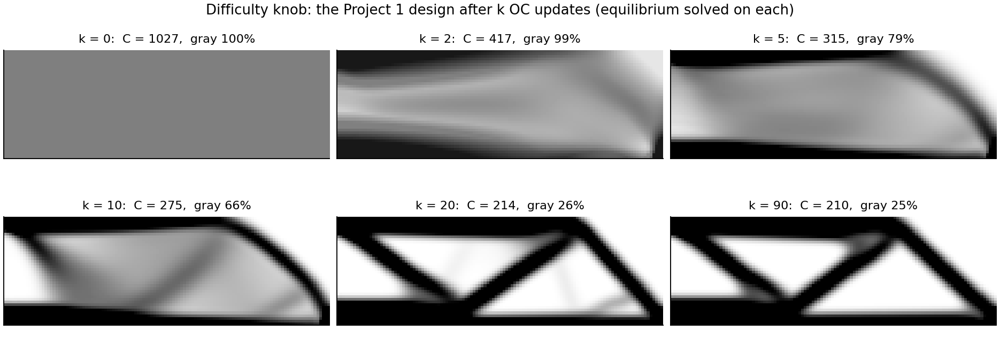
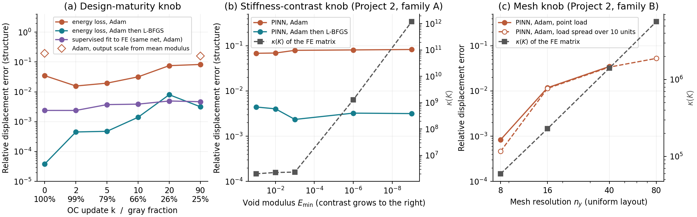
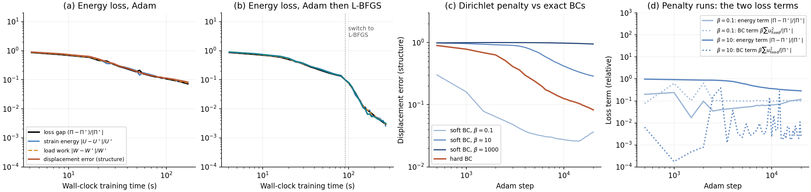
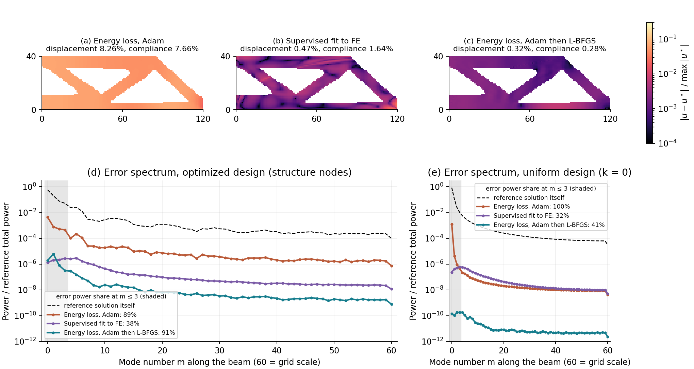
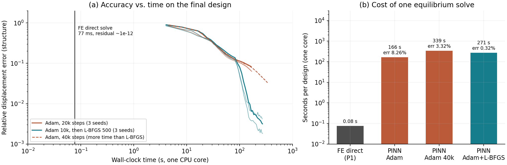

# Project 3: Training a Physics-Informed Neural Parameterization for Topology Optimization

**Kangzheng Liu · OptiForge · MAE 598/494 Design Optimization**  
**Official brief:** [Project 3: PINN/PINO in the Field](https://designinformaticslab.github.io/DesignOptimization2025/project3.html)  
**Researcher:** Dr. Leixin Ma, OASIS Lab, ASU · **Path:** C (diagnosis and fix)

## Summary

Dr. Ma works on topology optimization (TO), where every design update needs one equilibrium solve. Her group is exploring a neural parameterization of that solve: write the displacement field as a neural network and train it on the total potential energy, with no FE solutions as labels. This is a PINN in energy form. Her question for this project: on real TO designs, how accurately can such a network be trained, and what limits it? I built the minimal case on the Project 1 beam and the Project 2 energy formulation: a plain MLP trained on the exact FE energy of each design produced by the Project 1 optimizer.

- **The limit.** With Adam, the displacement error on the final design is 6.3–8.3% after 20,000 steps (three seeds). It is still falling, but only about as $1/t$, which in practice looks like a plateau. Along the knob it grows 5 times as the design matures, from 1.6% to 8.3%. The same network fitted directly to the FE answer stays at 0.24–0.49%. So the network can represent the answer; the energy loss is what is hard to optimize.
- **Cause.** The energy loss weights each error mode by its stiffness. The softest modes are the smooth deformations that carry the compliance, so they are learned last. Adam scales each parameter separately and cannot target these modes. On the uniform design, 99.9% of the Adam error lies in the five softest modes of $K$; for the supervised fit it is 0.4%.
- **Fix.** Switching to L-BFGS after 10,000 Adam steps gives 0.18–0.42% on the final design (three seeds), under the 1% target, in about 270 s. Adam given more time (40,000 steps, 339 s) reaches only 3.3%.
- **Project 2 links.** The solid–void contrast that broke CG in Project 2 does not matter here. Mesh refinement does: from $n_y=16$ to 80, $\kappa(K)$ grows 25 times and the Adam error 4.6 times.
- **A trap found on the way.** In float32, the element energy loses about 1% of its accuracy on the $120\times40$ mesh (5% on $240\times80$) to cancellation between large displacements and small strains. Removing each element's rigid translation first fixes it. All results use the fixed energy.
- **Value.** In 2D the FE direct solve takes 0.08 s, about 2,000–3,500 times less than training. These results say how to train such surrogates; they do not show a speedup.

## 1. Outreach Log

| Date | Person | How I found them | Format | Outcome |
|---|---|---|---|---|
| **[date]** | Dr. Leixin Ma, OASIS Lab | My PhD advisor | In person, about 30 min | Interviewed; brief and memo sent to her for review |

Reserved on the course participation sheet on **[date]**.

I am a PhD student in Dr. Ma's lab, so she was an easy contact. Her TO work is PDE-based and she had a specific question about neural networks, which made her a good fit. The study uses only the public Project 1 and 2 code, no unpublished code or data.

## 2. Problem Brief

*Reviewed by Dr. Ma on **[date]**.*

**What she works on.** Topology optimization: deciding where to put material so that a part is as stiff as possible for its weight (lightweight structures, architected materials). Every design update needs one equilibrium solve. In 2D this is cheap; the Project 1 beam solves in under 0.1 s. In 3D or with nonlinear materials, each solve is a large sparse factorization, often inside a Newton loop, repeated 100 or more times per design, and it dominates the cost.

**The PDE.** Static equilibrium with a density-dependent stiffness:

```math
\nabla\cdot\boldsymbol\sigma(\mathbf u)=\mathbf 0\ \text{in }\Omega,\qquad
\mathbf u=\mathbf 0\ \text{on }\Gamma_D,\qquad
\boldsymbol\sigma\mathbf n=\mathbf t\ \text{on }\Gamma_N,\qquad
\boldsymbol\sigma=E(\rho)\,\mathbb C:\boldsymbol\varepsilon(\mathbf u),
```

with $E(\rho)=E_{\min}+\rho^p(E_0-E_{\min})$ (SIMP). Equivalently, $\mathbf u$ minimizes the total potential energy $\Pi$. All the physics is known; only $\rho$ changes between solves.

**Where neural networks come in.** Her group is looking at a neural parameterization of the displacement: write $\mathbf u=\mathbf u_{\boldsymbol\theta}(\mathbf x)$ and train $\boldsymbol\theta$ by minimizing $\Pi$, with no FE solutions as labels. If it works, a trained network could be reused or warm-started across design updates. Training is usually done with Adam. How accurate this is on real TO designs, rather than on simple test cases, is the open part.

**Her question.** How close to FE does this get on the designs TO actually produces? If it falls short, is it the network, the loss, or the optimizer?

**Useful accuracy.** About 1% in compliance, the TO objective. Errors of several percent can change which elements an OC update adds or removes.

## 3. Minimal Case Formulation

### 3.1 PDE, domain, and discretization

The beam, load, supports, and FE model are those of Projects 1 and 2: a $120\times40$ half MBB beam with unit thickness, $120\times40$ square four-node plane-stress elements, $E_0=1$, $E_{\min}=10^{-9}$, $p=3$, $\nu=0.3$, a downward unit load at the upper-left node, $u_x=0$ on the left (symmetry) edge, and $u_y=0$ at the lower-right node. All quantities are in the normalized top88 units. As in Project 2, the FE displacement minimizes

```math
\Pi(\mathbf u)=\tfrac12\mathbf u^{\mathsf T}K(\boldsymbol\rho)\mathbf u-\mathbf F^{\mathsf T}\mathbf u .
```

### 3.2 The PINN

The network maps a node position to its displacement:

```math
u_x(x,y)=u_c\,\frac{x}{L}\,N_x(\hat x,\hat y;\boldsymbol\theta),\qquad
u_y(x,y)=u_c\,d(x,y)\,N_y(\hat x,\hat y;\boldsymbol\theta),
```

where $(\hat x,\hat y)=(x/L,\,y/H)$, $N$ is an MLP with four hidden layers of 64 tanh units (12,802 parameters), and $d=\min\big(1,\sqrt{(\hat x-1)^2+\hat y^2}\big)$ vanishes at the roller. The factors $x/L$ and $d$ impose the supports exactly ("hard" BCs). The scale $u_c=108$ is the Euler–Bernoulli midspan deflection of the full solid beam; it uses no FE information and only makes the network output order one.

The network is evaluated at the 4,961 FE nodes, and the loss is the **exact FE energy** of those nodal values, $L(\boldsymbol\theta)=\Pi(\mathbf u_{\boldsymbol\theta})$. With exact BCs and $K\mathbf u^\star=\mathbf F$,

```math
\Pi(\mathbf u)-\Pi(\mathbf u^\star)=\tfrac12\,\mathbf e^{\mathsf T}K\mathbf e,\qquad \mathbf e=\mathbf u-\mathbf u^\star .
```

So the loss gap is the squared energy norm of the error. I report it as $(\Pi-\Pi^\star)/|\Pi^\star|=\mathbf e^{\mathsf T}K\mathbf e/C^\star$.

**Why this is a PINN, and why the energy form.** A PINN parameterizes the solution of a PDE with a network and trains it on the physics instead of on data. The course's standard PINN uses the strong-form residual at collocation points. This project uses the energy form of the same idea (Deep Ritz [5], deep energy method [7]), for two reasons. First, it is the form Dr. Ma asked about. Second, the strong form does not suit TO designs: $\nabla\cdot(E(\rho)\,\mathbb C:\boldsymbol\varepsilon)$ contains $\nabla E$, and $E$ changes by nine orders of magnitude across a few elements at every solid–void boundary, while in the void the residual is multiplied by $10^{-9}$ and constrains nothing. The energy needs only first derivatives and handles the jumps naturally. Evaluating it with the FE element matrices makes its minimum exactly the FE solution, so any gap between the network and FE comes from the network or its training, not from discretization. (Neural reparameterization is also used for the design field in TO [12]; here it is applied to the displacement.)

The single-design MLP is a probe of how this kind of network trains, not a proposed faster solver; Section 4.6 shows it is much slower than FE in 2D.

**Training.** Adam: 20,000 steps, learning rate $10^{-3}$ decaying exponentially to $10^{-4}$, float32, with each element's rigid translation removed before its energy is evaluated (without this, float32 cancellation corrupts the energy; see Section 6). Adam then L-BFGS (the fix in Section 4.5): 10,000 Adam steps, then 500 L-BFGS iterations (at most 20 evaluations each, memory 50, strong-Wolfe line search) in float64. One CPU core per run; network seed 0 unless stated.

**Error measures.** Relative $L^2$ displacement error on the structure (nodes that touch an element with $\rho\ge0.5$, as in Project 2), relative compliance error, and the loss gap.

### 3.3 What is simplified, and why the hard part is kept

| Research problem | Minimal case | Why the simplification is safe for this question |
|---|---|---|
| 3D, many unknowns | 2D, 9,922 nodal displacements (9,880 free) | The mechanism studied (how the energy loss shapes training) does not need 3D. The cost conclusions do; see Section 6. |
| Hyperelastic materials | Linear elasticity | $\Pi$ becomes quadratic, so the loss gap equals the energy-norm error and the reference is exact. Nonlinear failures are outside this case. |
| Network that takes the design as input and is reused across designs | MLP trained on one design at a time | Isolates the loss and optimizer, which is what the question is about. |
| Penalty BCs, common in practice | Exact BCs (penalty tested separately) | Removes a known, separate failure (Section 4.4, B5). |

**Kept:** the actual SIMP density fields that OC produces (a $10^9$ solid–void contrast, gray regions, slender members), the same energy loss, and the same optimizer.

### 3.4 Difficulty knob and path

**Primary knob: design maturity $k$**, the number of OC updates in the Project 1 run. I re-run Project 1 with its own code and solve equilibrium on the designs after $k=0,2,5,10,20,90$ updates; $k=0$ is the uniform gray start and $k=90$ is the final Project 1 design (reproduced exactly; compliance 210.0406).



**Secondary knobs from Project 2:** the void modulus $E_{\min}$ (solid–void contrast, Project 2 family A) on the final design, and the mesh resolution $n_y$ (Project 2 family B) on the uniform design. Project 2 showed both make $K$ badly conditioned.

**Path C:** measure how far the training gets along the knob, find the cause of the shortfall with controlled experiments, then fix it.

## 4. Experiments

### 4.1 P1 – Baseline

The reference is the Project 1 sparse direct solve (SciPy SuperLU, one core) on each design. Its relative residual is below $6\times10^{-12}$ on every design, and the final design reproduces the Project 1 compliance, 210.0406.

| OC update $k$ | 0 | 2 | 5 | 10 | 20 | 90 |
|---|---:|---:|---:|---:|---:|---:|
| Compliance | 1026.8 | 416.6 | 314.7 | 275.3 | 214.5 | 210.0 |
| Gray fraction ($0.1<\rho<0.9$) | 100% | 99% | 79% | 66% | 26% | 25% |
| FE solve time (median of 7) | 79 ms | 92 ms | 84 ms | 83 ms | 81 ms | 77 ms |

### 4.2 P3 – Accuracy along the knob



Panel (a) and the table give the relative displacement error on the structure after the full training budget (seed 0).

| OC update $k$ | 0 | 2 | 5 | 10 | 20 | 90 |
|---|---:|---:|---:|---:|---:|---:|
| Energy loss, Adam (20k steps) | 3.48% | 1.57% | 1.95% | 3.17% | 7.53% | 8.26% |
| Energy loss, Adam then L-BFGS | 0.004% | 0.045% | 0.048% | 0.14% | 0.80% | 0.32% |
| Supervised fit to FE, Adam (20k steps) | 0.24% | 0.24% | 0.37% | 0.39% | 0.49% | 0.47% |

From $k=2$ to $k=90$ the Adam error grows 5.3 times, and it is above the 1% target on every design. Three seeds on the final design give 6.3%, 6.3%, and 8.3%. The error is still falling at the end (Section 4.3), so this is a slow tail rather than a hard floor: Adam with twice the steps (339 s) reaches 3.3%.

The uniform start, $k=0$, does not fit the trend: it is harder than $k=2$ (3.5% against 1.6%). I did not isolate why. One obvious suspect, the fixed output scale $u_c$ (displacements at $k=0$ are 9.5 times $u_c$), is ruled out: setting $u_c$ from each design's mean modulus makes both $k=0$ and $k=90$ worse (19.3% and 15.7%). That test does show the result is sensitive to the output scale; all comparisons in this report use the same FE-free scale for every design.

### 4.3 P2 – Loss components



With exact BCs the loss has one term, so panels (a) and (b) split it into strain energy $U$ and load work $W$ and compare each with its FE value ($U^\star=C^\star/2$, $W^\star=C^\star$). All energies are logged in float64.

- **No imbalance.** All curves fall together. Under Adam they fall roughly as $1/t$ (log–log slope $-0.84$ after the first 15 s), slower than any fixed linear rate. That is what a first-order method gives when the curvatures are spread over many orders of magnitude: each error mode decays at its own rate, and the many slow ones add up to a power law.
- **The loss gap tracks the compliance error.** On the final design the loss gap is 7.2% and the compliance error 7.7% (Adam); 0.30% and 0.28% (L-BFGS). This is the Ritz property: if the field cannot be improved by rescaling it, $\mathbf F^{\mathsf T}\mathbf u=\mathbf u^{\mathsf T}K\mathbf u$, so $\Pi(\mathbf u)=-\tfrac12\mathbf F^{\mathsf T}\mathbf u$ and the relative gap equals the relative compliance shortfall. On other designs, where the amplitude is not yet optimal, the two differ by up to a factor of 3. In every energy-trained run with exact BCs, the PINN compliance is below the FE value (193.9 against 210.0 for Adam on the final design): **an under-trained energy PINN makes a design look stiffer than it is**, the same bias as truncated CG in Project 2. Since $\Pi^\star$ is unknown in practice, the loss value alone cannot tell how far off the compliance is.
- **Penalty BCs (panel c).** With $\beta\sum u_{\text{fixed}}^2$ in the loss, a weak spring ($\beta=0.1$) lets the supports move (2.4% of the peak displacement); the error falls to 2.6% at step 14,000 and then rises to 3.6% as training converges to the wrong, spring-supported problem. A stiff spring ($\beta=10^3$) adds very stiff modes, and the error is still 95% after 20,000 steps. Exact BCs avoid this trade-off; it is a separate and avoidable failure.

### 4.4 Diagnosis: what limits the accuracy

**B1 – Expressivity or optimization?** The Krishnapriyan test: train the same network, with the same Adam budget, to fit the FE displacement directly ($\lVert\mathbf u-\mathbf u^\star\rVert^2/\lVert\mathbf u^\star\rVert^2$). It reaches 0.24–0.49% on every design (table in 4.2), 18 times below the energy-trained error on the final design. **The network can represent the answer; the failure is in the energy-loss landscape.**

The two trainings differ only by $K$ inside the loss. For the energy loss the gradient is $J^{\mathsf T}K\mathbf e$; for the supervised loss it is $J^{\mathsf T}\mathbf e$ (with $J=\partial\mathbf u/\partial\boldsymbol\theta$). In the small-step limit the error evolves as

```math
\dot{\mathbf e}=-\Theta K\mathbf e\quad\text{(energy)},\qquad \dot{\mathbf e}=-\Theta\,\mathbf e\quad\text{(supervised)},\qquad \Theta=JJ^{\mathsf T}.
```

Write $\mathbf e$ in the eigenvectors $\mathbf v_i$ of $K$. With the energy loss, the component along a soft mode (small $\lambda_i$) gets a gradient scaled by $\lambda_i$ and shrinks slowly. In an elastic body the soft modes are smooth, global deformations, and they are the ones that carry the compliance: on the uniform design the softest mode alone carries 93% of it (Project 2). So the energy loss learns last exactly the part of the answer that TO needs most, and it barely penalizes the leftover: an error $a\mathbf v_i$ costs only $\tfrac12\lambda_i a^2$.

This predicts where the error should be: in the softest modes for energy training, and not there for supervised training.

**B2 – P4: where is the error?**



- **Maps (a–c).** The Adam error is smooth and spread over the whole structure: a missing share of the global deflection. The supervised error is patchy and local. After L-BFGS the error is smooth again but about 25 times smaller.
- **Spectra (d, e)**, along the beam axis. With the energy loss, 89% (final design) and over 99% (uniform design) of the error power sits in the lowest four modes ($m\le3$, wavelengths of at least the beam height). For the supervised fit it is 38% and 32%; the rest is spread toward high wavenumbers. So the energy-trained error is **not** spectral bias, which would leave high-frequency error, as it does for the supervised fit.
- **Eigenbasis of $K$** (uniform design, 30 softest modes). The five softest modes carry 95.6% of the compliance. They hold 99.9% of the squared Adam error (88% in the softest mode alone), but only 0.36% of the supervised error.

This is the predicted pattern. The supervised fit has the opposite problem: its error is small in displacement (0.47%) but rough, and rough errors are stiff, so the energy of its error, $\mathbf e^{\mathsf T}K\mathbf e$, is 1.6 times the compliance. A field can be close in displacement and far from equilibrium.

**B3 – Why Adam cannot fix it.** Adam divides each parameter's step by the running size of that parameter's own gradient: it is a diagonal preconditioner in $\boldsymbol\theta$. A soft global mode is a direction in $\boldsymbol\theta$ that mixes all parameters, so no per-parameter scaling picks it out. This is the Project 2 situation in a new space: Jacobi (diagonal) scaling could not fix the mesh-induced soft mode, because that mode was not aligned with any coordinate; CG could, because it builds directions from curvature.

**B4 – Do Project 2's two mechanisms transfer?** Panels (b) and (c) of the knob figure.

- **Solid–void contrast: no.** Lowering $E_{\min}$ from $10^{-1}$ to $10^{-9}$ raises $\kappa(K)$ from $2.0\times10^6$ to $1.2\times10^{12}$, the change that made CG fail in Project 2. The Adam error moves only from 6.8% to 8.3%, and the L-BFGS error stays at 0.2–0.4%. The void modes are soft, but they deform material that carries no load. The solution has almost no component on them, the loss gives them almost no weight, and the network leaves them alone, which is correct for compliance. CG in Project 2 had to drive every residual component to zero, void ones included.
- **Mesh refinement: yes.** On the uniform design the Adam error grows from 0.084% ($n_y=8$) to 1.2% ($n_y=16$) and 3.5% ($n_y=40$). The point load is not the cause: spreading it over 10 units of the top edge gives 0.046%, 1.1%, 3.4%, and 5.2% at $n_y=80$. From $n_y=16$ to 80, $\kappa(K)$ grows 25 times and the error 4.6 times, a weaker dependence than plain gradient descent's but not a negligible one. My reading: the mesh sets the stiffest deformation the energy can "see". On a coarse mesh the network's fine-scale content falls between nodes and costs no energy; refining exposes it and widens the gap between the fastest and slowest error components in $\Theta K$. One alternative is not ruled out: the roller is still a point support, whose singular field also sharpens with refinement.

**B5 – Penalty BCs** are a second, separate failure (Section 4.3, panel c).

**Root cause.** The energy loss is ill-conditioned along the smooth, compliance-carrying modes of the structure, and Adam's diagonal preconditioning cannot reach them. It is not the network's capacity (B1) or the solid–void contrast (B4); mesh refinement makes it worse. Why more mature designs are worse (4.2) is not pinned down here; my hypothesis is that slender members add soft bending modes that carry compliance.

### 4.5 Path C – Fix: curvature-aware optimization

**The remedy.** Train with Adam for 10,000 steps, then switch to L-BFGS for 500 iterations. L-BFGS builds an approximation of the inverse Hessian, here $(J^{\mathsf T}KJ)^{-1}$ near the solution, from recent gradient differences. Directions where the gradient changes little, the soft modes, get large steps. That targets the diagnosed mechanism, in the way CG targeted the soft mode in Project 2. Adam goes first, as is common practice (Rathore et al. [9] use the same combination for residual PINNs): L-BFGS's curvature model comes from local gradient differences and is most useful near a minimum. I did not test L-BFGS from the start.

**Before and after (final design).** Three seeds: mean (range).

| Measure | Adam, 20k steps | Adam 10k, then L-BFGS 500 |
|---|---:|---:|
| P3: displacement error, structure | 7.0% (6.3–8.3%) | **0.31% (0.18–0.42%)** |
| Compliance error | 6.5% (5.9–7.7%) | **0.28% (0.18–0.40%)** |
| P2: loss gap $(\Pi-\Pi^\star)/\lvert\Pi^\star\rvert$ | 6.0% (5.3–7.2%) | 0.31% (0.22–0.40%) |
| P4: error power relative to the solution (seed 0) | $6.8\times10^{-3}$ | $1.0\times10^{-5}$ |
| P4: share at $m\le3$ (seed 0) | 89% | 91% |
| P5: training time (one core) | 168 s (166–171 s) | 271 s (268–273 s) |

The control for "it just had more time": Adam with 40,000 steps runs longer (339 s) and reaches 3.3%. Along the knob, L-BFGS lowers the error 9 to 900 times on every design and keeps all of them under the 1% target (largest 0.80% at $k=20$; table in 4.2).

The fix acts on the soft modes, as intended. On the uniform design, the five softest modes held 99.9% of the Adam error; after L-BFGS they hold 12% of an error 900 times smaller. On the final design the remaining error is still mostly smooth (91% at $m\le3$), but its power is 680 times lower.



### 4.6 P5 – Cost and break-even

All runs used one core of a 2.1 GHz Intel Xeon (x86-64 Linux, no GPU), two runs in parallel.

| | FE direct solve | PINN, Adam | PINN, Adam then L-BFGS |
|---|---:|---:|---:|
| Time per design | 0.077 s | 166 s training | 271 s training |
| Inference | — | 2.2 ms | 2.3 ms |
| Error (final design, seed 0) | $\sim10^{-12}$ residual | 8.3% | 0.32% |

A single-instance PINN answers one design only, so in a TO loop it must be retrained at every update and never breaks even. For an operator trained once and reused, $N^\star=T_{\text{train}}/(T_{\text{sol}}-T_{\text{inf}})$. Even if it trained as fast as one PINN here, $N^\star\approx3{,}600$ solves, against about 90 solves in one Project 1 run. To pay off within one 2D run, its total training would have to take under $90\times(0.077-0.002)\approx6.7$ s. In 2D, the direct solve wins by three orders of magnitude.

## 5. Recommendation Memo

> **To:** Dr. Leixin Ma, OASIS Lab · **From:** Kangzheng Liu · **Date:** **[date]**  
> **Re:** How accurately a neural parameterization trains on TO designs, and a cheap fix
>
> **Question.** You asked how accurately a network trained only on the potential energy can represent the displacement on real TO designs, and what limits it: the network, the physics, or the optimizer.
>
> **What I tested.** A plain MLP trained on the exact FE energy of the 2D half-MBB designs produced by SIMP–OC (120×40 mesh, linear elasticity, exact BCs). The energy loss and the Adam optimizer used for such networks, a simple network, one design at a time. Reference: sparse direct FE.
>
> **Findings.**
> 1. **It is the optimizer on this loss, not the network.** The same network fitted directly to the FE answer reaches 0.2–0.5% on every design. Trained on the energy, it reaches 6–8% on the final design and gets worse as the design matures (1.6% early, 8.3% final).
> 2. **Mechanism.** The energy loss weights each error mode by its stiffness. The smooth global modes that carry the compliance are the softest, so they are learned last, and the loss barely sees what is left. Adam's per-parameter scaling cannot reach these modes. On the uniform design, 99.9% of the Adam error lies in the five softest modes of $K$.
> 3. **Fix.** 10,000 Adam steps, then L-BFGS: 0.18–0.42% on the final design over three seeds, in about 270 s. Twice the Adam steps reach only 3.3%.
> 4. **Bias to watch.** An under-trained energy surrogate under-predicts compliance (in every exact-BC run here, and provably once the field's amplitude is optimal), so the design looks stiffer than it is. The loss value cannot reveal this without a reference.
> 5. **Float32 trap.** Evaluating the element energy in float32 lost 1% (120×40) to 5% (240×80) of accuracy at the FE solution, because large displacements cancel against small strains. Subtracting each element's rigid translation before the quadratic form fixes it at no cost. Worth checking in any energy-trained code.
> 6. **Not the cause:** the $E_{\min}$ contrast. **Makes it worse:** mesh refinement. **A separate failure:** penalty BCs (a weak penalty lets supports move; a strong one stalls training). Exact BC imposition removes it.
> 7. **Cost.** In 2D the FE direct solve takes about 0.08 s; training takes minutes. Any speedup has to come from 3D or nonlinear problems, or from reuse across designs.
>
> **Confidence.** High for the mechanism in 2D linear elasticity (controlled comparisons, three seeds on the final design). Medium for larger networks that take the design as input, and for hyperelastic materials: the loss is then nonconvex, and L-BFGS may need safeguards against bad line searches.
>
> **Recommendation.** Before changing the architecture, add an L-BFGS (or other curvature-aware) phase to the training, check the float32 energy against float64 at a known solution, impose BCs exactly, and report compliance error against FE rather than the loss.
>
> **Next experiment.** Repeat the Adam versus Adam-then-L-BFGS comparison with a network that takes the design as input, on one hyperelastic benchmark, and measure the warm-start cost per OC update against an FE solve.

## 6. Assumptions and Limitations

- **2D, linear, one load case.** The mechanism (stiffness-weighted loss, diagonal optimizer) does not depend on dimension. Cost conclusions do: in 3D a direct solve grows much faster with size, so the break-even changes.
- **Hyperelastic materials are not tested.** With SVK or Neo-Hookean, $\Pi$ is nonconvex and can lose ellipticity; L-BFGS line searches can then fail, and new failure modes appear.
- **MLP, one design per network.** Networks used in practice take the design as input and are warm-started across designs. Warm starting changes the starting error, not the conditioning, so I expect the same slow modes, but I did not test it.
- **Output scale matters.** Setting $u_c$ from the mean modulus (2.4 times larger on the final design, 8 times on the uniform one) made the Adam error 1.9 and 5.6 times larger. The knob comparisons use one fixed, FE-free scale for all designs.
- **Open points.** Why the uniform start ($k=0$) is harder than $k=2$, and why mature designs are harder, are not isolated. The mesh effect is explained only qualitatively, and the point-support singularity is not separated from it.
- **Precision.** Adam runs use float32 with the translation-free element energy, which matches float64 to $2\times10^{-6}$ at the FE solution on both the $120\times40$ and $240\times80$ meshes. An earlier version without this fix had a 1–5% energy error that changed the mesh results; it was discarded and everything was re-run. L-BFGS runs in float64; logged energies and all errors are computed in float64.
- **Error measure.** Errors are measured on the structure (nodes touching $\rho\ge0.5$), as in Project 2. In the void, L-BFGS errors are larger (up to 2.5% over all nodes), which does not affect compliance.
- **Seeds.** One seed except on the final design. There, three seeds span 6.3–8.3% for Adam and 0.18–0.42% for L-BFGS, so single-seed differences smaller than about 1.5 times are not meaningful.

## Reproduction

Python 3.12, CPU only. From the repository root:

```bash
python -m pip install -r projects/03_neural_operator/requirements.txt
python projects/03_neural_operator/src/run_experiments.py   # about 75 min on 2 cores
python projects/03_neural_operator/src/make_figures.py      # figures, summary.json, checks
```

[`run_experiments.py`](../src/run_experiments.py) re-runs the Project 1 optimizer to get the designs, solves the FE references, and trains every configuration with fixed seeds (network seed in each run id). Re-running a configuration on the same machine reproduces its numbers bit for bit (checked for one run). Results: [`runs.csv`](../results/runs.csv), [`histories/`](../results/histories/), [`reference.json`](../results/reference.json), [`summary.json`](../results/summary.json), [`metadata.json`](../results/metadata.json).

**Checks** (in [`make_figures.py`](../src/make_figures.py), recorded in `summary.json`):

- The re-run Project 1 design matches the saved one exactly, and its FE compliance matches Project 1 to $10^{-9}$.
- $\kappa(K)$ for the $E_{\min}$ and mesh knobs matches the Project 2 values to $10^{-3}$.
- The float32 strain energy at the FE solution matches float64 to $10^{-5}$ ($120\times40$ final design and $240\times80$ uniform design).
- For the final PINN fields, $\Pi-\Pi^\star=\tfrac12\mathbf e^{\mathsf T}K\mathbf e$ holds to $10^{-9}$, and the supports are exactly zero.
- **Hand check of one error value.** The load is $-1$ on the vertical DOF of the top-left node, so compliance is $-u_y$ there. The Adam PINN gives $u_y=-193.94$ against the FE value $-210.04$: $(210.04-193.94)/210.04=7.66\%$, matching the reported compliance error.

## References

1. MAE 598/494, [Project 3: PINN/PINO in the Field](https://designinformaticslab.github.io/DesignOptimization2025/project3.html), and [AI for Physics: Is Physics Compressible?](https://designinformaticslab.github.io/DesignOptimization2025/ai_for_pde.html)
2. K. Liu, [Project 1: SIMP–OC topology optimization](../../01_problem_formulation/report/report.md); [Project 2: Ill-conditioning in the MBB beam equilibrium solve](../../02_gradient_descent/report/report.md).
3. A. S. Krishnapriyan, A. Gholami, S. Zhe, R. M. Kirby, and M. W. Mahoney, "Characterizing possible failure modes in physics-informed neural networks," *NeurIPS*, 2021.
4. S. Wang, X. Yu, and P. Perdikaris, "When and why PINNs fail to train: A neural tangent kernel perspective," *J. Comput. Phys.*, 449, 110768, 2022.
5. W. E and B. Yu, "The Deep Ritz method: A deep learning-based numerical algorithm for solving variational problems," *Commun. Math. Stat.*, 6, 1–12, 2018.
6. E. Andreassen, A. Clausen, M. Schevenels, B. S. Lazarov, and O. Sigmund, "Efficient topology optimization in MATLAB using 88 lines of code," *Struct. Multidiscip. Optim.*, 43, 1–16, 2011.
7. E. Samaniego et al., "An energy approach to the solution of partial differential equations in computational mechanics via machine learning: Concepts, implementation and applications," *Comput. Methods Appl. Mech. Eng.*, 362, 112790, 2020.
8. J. Nocedal and S. J. Wright, *Numerical Optimization*, 2nd ed., Springer, 2006, Chapter 7 (L-BFGS).
9. P. Rathore, W. Lei, Z. Frangella, L. Lu, and M. Udell, "Challenges in training PINNs: A loss landscape perspective," *ICML*, PMLR 235, 2024.
10. J. Müller and M. Zeinhofer, "Achieving high accuracy with PINNs via energy natural gradient descent," *ICML*, PMLR 202, 2023.
11. N. McGreivy and A. Hakim, "Weak baselines and reporting biases lead to overoptimism in machine learning for fluid-related partial differential equations," *Nat. Mach. Intell.*, 6, 1256–1269, 2024.
12. S. Hoyer, J. Sohl-Dickstein, and S. Greydanus, "Neural reparameterization improves structural optimization," arXiv:1909.04240, 2019.
