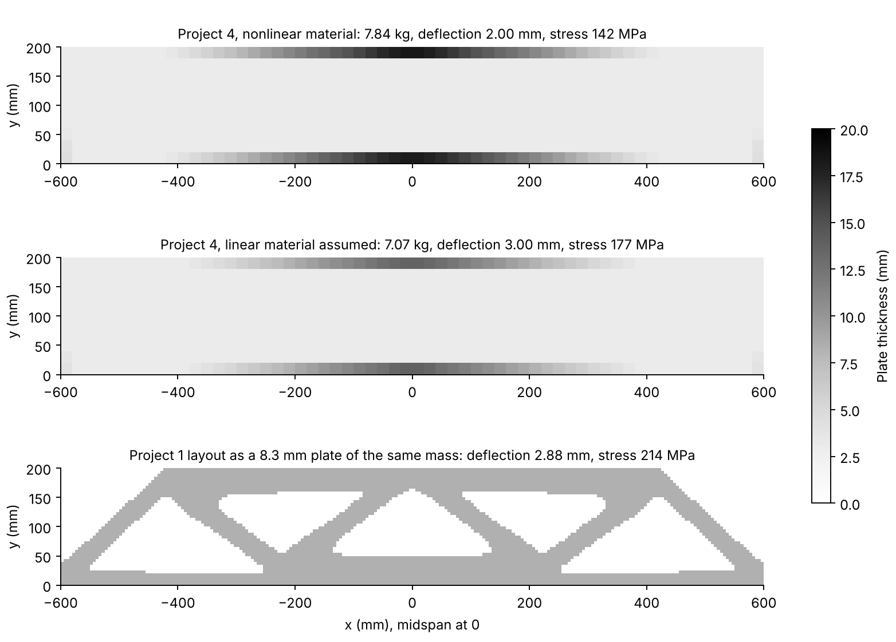
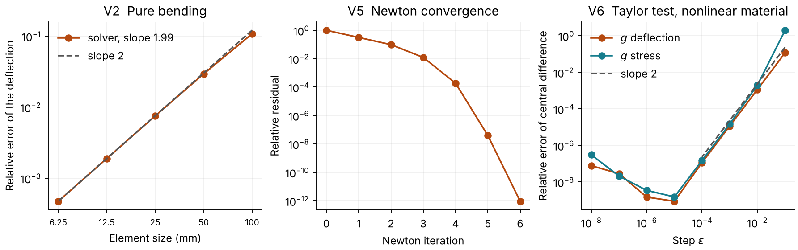
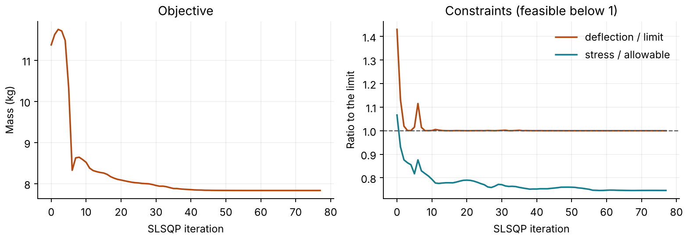
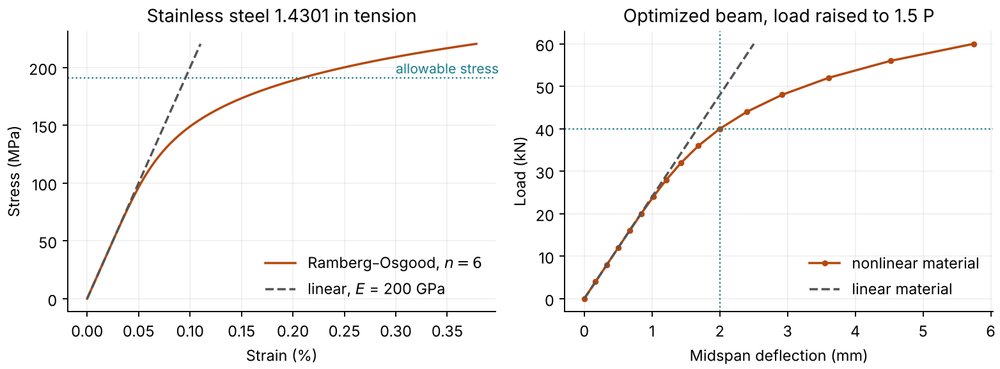

# Project 4: The Project 1 Beam with a Real Material and Real Limits

**Kangzheng Liu · OptiForge · MAE 598/494 Design Optimization**  
**Official brief:** [Project 4: PDE-Constrained Design Optimization](https://designinformaticslab.github.io/DesignOptimization2025/project4.html)  
**Structure:** the MBB beam of Projects 1 to 3, as a stainless-steel plate beam · **Nonlinear component:** N2, nonlinear material · **Code:** [repository](https://github.com/Liukz233/MAE598-Design-Optimization/tree/main/projects/04_engineering_design)

## Summary

Projects 1 to 3 worked on one problem, the MBB beam. [Project 1](https://github.com/Liukz233/MAE598-Design-Optimization/blob/main/projects/01_problem_formulation/report/report.md) found its stiffest layout with SIMP and OC, [Project 2](https://github.com/Liukz233/MAE598-Design-Optimization/blob/main/projects/02_gradient_descent/report/report.md) studied the conditioning of its equilibrium solve, and [Project 3](https://github.com/Liukz233/MAE598-Design-Optimization/blob/main/projects/03_neural_operator/report/report.md) trained a network on its energy. All three used a unit load, a unit modulus and a linear material, and none of them looked at stress or at a deflection limit.

Project 4 gives the same beam real dimensions and real requirements. A 1200 mm stainless-steel beam, 200 mm deep, carries a 40 kN wheel load at midspan. I chose the plate thickness of each 20 mm tile (300 variables, 3 to 20 mm) so that the beam is as light as possible, deflects no more than span/600, and stays below the allowable stress. Stainless steel has a curved stress–strain law from low stress, so the equilibrium equation is nonlinear. The mesh numbering, supports and linear element matrix are imported from the Project 1 code.

- The optimized beam weighs 7.84 kg and meets both limits. The thinnest uniform plate that meets them is 7.08 mm and weighs 13.42 kg, so the optimum is 42% lighter. The optimizer turns the plate into an I-beam: flanges 18 mm thick at midspan that taper towards the supports, and a web at the minimum 3 mm.
- Deflection governs. At the optimum the deflection is at its limit of 2.0 mm and the peak stress is 142 MPa, against an allowable 191 MPa.
- The nonlinear material changes the design. Optimizing with a linear material gives a beam of 7.07 kg that meets both limits in its own analysis. With the real material it deflects 3.00 mm, 50% over the limit. Meeting the limit with the real material costs 11% more steel.
- The Project 1 layout, built as a plate of the same mass as the optimum, fails both limits: 2.88 mm and 214 MPa (Section 7).
- Newton's method solves the state equation in 5 iterations. The adjoint at the converged state gives both constraint gradients in 0.24 s, against 71 s for finite differences.
- The solver passes all 17 checks of the verification ladder. One of them reproduces the Project 1 compliance of 210.04 to 10 digits (Section 3).



*The interactive 3D comparison is on the [report site](https://liukz233.github.io/MAE598-Design-Optimization/). This static figure is the one from Section 7.*

<p class="caption">Left: the uniform starting plate. Right: the optimized beam. Drag to rotate (the two views share one camera) and scroll to zoom. Half the beam was analysed and the other half is its mirror image. Geometry and plate thickness are to scale. Displacements are drawn 40 times too large by default, and the slider changes that factor. Each element is drawn as four triangles around its centre point, which is where the bilinear shape functions put it. The arrow is the load and the two cones are the supports. The play button steps the right panel through the optimizer's iterations.</p>

## 1. Structure and formulation

**Why this problem.** Project 1 asked where to put material so that the beam is as stiff as possible for a given volume. That is a useful first question, but a beam is not accepted on stiffness per unit load. It is accepted when its deflection and stress under the working load are within limits, for the material it is made of. Project 3 named nonlinear materials as a case where the equilibrium solve inside the design loop becomes expensive. Project 4 is that case, on the same beam.

**Setup.** The numbers describe a short runway beam for a hoist in a wet or corrosive plant, where stainless steel is used. They were chosen so that the 6:1 beam of Project 1 becomes a real part.

| Quantity | Value | Source |
|---|---|---|
| Beam | Span 1200 mm, depth 200 mm, simply supported. Half of it is modelled, the 3:1 half MBB beam of Project 1 | Project 1 [7] |
| Material | Austenitic stainless steel 1.4301 (AISI 304): $E=200$ GPa, 0.2% proof stress $f_y=210$ MPa, $\nu=0.3$, $\rho=7900$ kg/m³ | EN 1993-1-4 [2] |
| Stress–strain law | Ramberg–Osgood, $\varepsilon=\sigma/E+0.002\,(\sigma/f_y)^n$ with $n=6$ | [2], [4] |
| Load | $P=40$ kN at midspan on an 80 mm bearing pad; each reaction on a 40 mm pad | Design assumption |
| Deflection limit | Span/600 $=2.0$ mm at midspan | Runway beams under the maximum wheel load, CMAA 70 [3] |
| Allowable stress | $f_y/\gamma_{M0}=210/1.1=190.9$ MPa | [2] |
| Plate thickness | 3 to 20 mm | Design assumption: 20 mm stock, 3 mm thinnest web |

**Design variables.** One variable per tile, $x_j\in[0,1]$, $j=1,\dots,300$, with tile thickness

```math
t_j = t_{\min} + (t_{\max}-t_{\min})\,x_j ,\qquad t_{\min}=3\ \text{mm},\quad t_{\max}=20\ \text{mm}.
```

This is the SIMP parameterization of Project 1 with exponent $p=1$: thickness multiplies the stiffness linearly, and an intermediate value is a real plate, so no penalization is needed.

**Objective and constraints.** With $\delta$ the downward displacement of the bottom fibre at midspan and $\bar\sigma_j$ the von Mises stress of the stress tensor averaged over tile $j$:

```math
\begin{aligned}
\min_{\mathbf x}\quad & m(\mathbf x)=2\rho A_{\text{tile}}\sum_j t_j \\
\text{s.t.}\quad & g_\delta(\mathbf x)=\frac{\delta}{\delta_{\max}}-1\le 0,\\
& g_\sigma(\mathbf x)=\mathrm{KS}\!\left(\frac{\bar\sigma_j}{\sigma_{\text{allow}}},\ j=1,\dots,300\right)-1\le 0,\\
& 0\le x_j\le 1 ,
\end{aligned}
```

where the displacement field solves the state equation of Section 2. The largest tile stress is not differentiable where the critical tile changes, so the stress constraint uses the Kreisselmeier–Steinhauser aggregate [5]

```math
\mathrm{KS}(\mathbf a)=a_{\max}+\frac1{\rho_{KS}}\ln\sum_j e^{\rho_{KS}(a_j-a_{\max})},\qquad
a_{\max}\le \mathrm{KS}(\mathbf a)\le a_{\max}+\frac{\ln N}{\rho_{KS}} .
```

With $\rho_{KS}=200$ and $N=300$ it overestimates the peak by at most 2.9%. The stress is averaged over a tile because the tile is the smallest feature of the design, and because a stress taken at one point of the mesh did not converge under refinement (Sections 2 and 10).

## 2. Analysis model

**Governing equations.** The beam is a thin plate loaded in its plane, so it is in plane stress. With thickness $t(x,y)$, displacement $\mathbf u$ and strain $\boldsymbol\varepsilon(\mathbf u)$,

```math
\nabla\!\cdot\!\big(t\,\boldsymbol\sigma\big)=\mathbf 0\ \text{in }\Omega,\qquad
t\,\boldsymbol\sigma\,\mathbf n=\bar{\mathbf q}\ \text{on the pads},\qquad
u_x=0\ \text{at midspan},
```

and the rest of the boundary is free. These are the equations of Projects 1 to 3 with a thickness in place of the SIMP modulus. What is new is the material:

```math
\boldsymbol\sigma=g\,\mathbf C\,\boldsymbol\varepsilon,\qquad
g=\frac{s}{s_e},\qquad
s_e=\sqrt{E\,\boldsymbol\varepsilon^{\mathsf T}\mathbf C\,\boldsymbol\varepsilon},\qquad
s+0.002\,E\left(\frac{s}{f_y}\right)^{n}=s_e ,
```

where $\mathbf C$ is the linear plane-stress matrix. $s_e$ is the stress a linear material would carry at this strain energy, and $s$ is the stress the Ramberg–Osgood curve gives instead, found by a scalar Newton iteration at each integration point. In uniaxial tension the law is exactly $\varepsilon=\sigma/E+0.002(\sigma/f_y)^n$ (check V5). The secant stiffness $g$ is 0.96 at 100 MPa and 0.46 at the allowable stress, so the material has lost more than half its stiffness before it reaches the stress it is allowed to carry. With $g=1$ the model is the linear one of Project 1.

**Discretization.** 60 × 20 four-node bilinear elements of 10 mm (2,540 unknowns). Each tile covers 2 × 2 elements. The element numbering, the supports and the closed-form linear element matrix come from [`top88.py`](https://github.com/Liukz233/MAE598-Design-Optimization/blob/main/projects/01_problem_formulation/src/top88.py) of Project 1 [8], imported and not copied. [`beam.py`](https://github.com/Liukz233/MAE598-Design-Optimization/blob/main/projects/04_engineering_design/src/beam.py) adds the strain–displacement matrices at 2 × 2 Gauss points, the material law, stresses, Newton's method and the adjoint. No FE library is used. The discrete residual and its tangent are

```math
\begin{aligned}
&\mathbf R(\mathbf u;\mathbf t)=\sum_e t_e\,\mathbf f_e(\mathbf u_e)-\mathbf F=\mathbf 0,\qquad
\mathbf f_e=\int_{\Omega_e}\mathbf B^{\mathsf T}\boldsymbol\sigma\,dA,\\
&\mathbf K_T=\sum_e t_e\int_{\Omega_e}\mathbf B^{\mathsf T}\mathbf D_t\,\mathbf B\,dA,\qquad
\mathbf D_t=g\,\mathbf C+\big(s'-g\big)\frac{(\mathbf C\boldsymbol\varepsilon)(\mathbf C\boldsymbol\varepsilon)^{\mathsf T}}{\boldsymbol\varepsilon^{\mathsf T}\mathbf C\boldsymbol\varepsilon},
\qquad s'=\frac{ds}{ds_e} .
\end{aligned}
```

$\mathbf K_T$ is symmetric positive definite because the stress–strain curve keeps rising. Newton's method starts from zero displacement, halves the step if the residual does not fall, and stops when $\lVert\mathbf R\rVert/\lVert\mathbf F\rVert<10^{-9}$.

**Loads and supports.** The load and the reactions are line loads on the pads, which keeps the stress finite. They are in equilibrium, so the roller of Project 1 at the lower outer corner only removes the rigid vertical motion and carries no force.

**Assumptions.**

- Plane stress, small strains and small displacements. The deflection is 1/600 of the span.
- The material law is nonlinear elastic. It follows the Ramberg–Osgood curve on loading and would follow it back on unloading, so it gives no permanent set. It uses an energy-equivalent stress and a constant Poisson ratio.
- The plate does not buckle. A 3 mm web and a compression flange without lateral support need a separate check (Section 10).
- Self-weight is ignored. The beam weighs about 8 kg and carries 40 kN.

**Mesh check.** The optimized design re-analysed on coarser and finer meshes:

| Element size (mm) | Unknowns | Deflection (mm) | Peak tile stress (MPa) |
|---:|---:|---:|---:|
| 20 | 670 | 1.987 | 142.49 |
| 10 | 2,540 | 2.000 | 142.50 |
| 5 | 9,880 | 2.003 | 142.50 |
| 2.5 | 38,960 | 2.004 | 142.50 |

## 3. Verification

All checks run from [`verify.py`](https://github.com/Liukz233/MAE598-Design-Optimization/blob/main/projects/04_engineering_design/src/verify.py) each time the results are regenerated.

|  | Test | Quantity | Solver | Exact | Rel. error |  |
|---|---|---|---:|---:|---:|---|
| V1 | Uniform tension, linear material | elongation (m) | 0.0002835 | 0.0002835 | 5.7e-16 | pass |
| V1 | Uniform tension, linear material | lateral contraction (m) | -2.835e-05 | -2.835e-05 | 1.4e-14 | pass |
| V1 | Pure bending, finest mesh | deflection of the mid-depth line (m) | 0.0003373406 | 0.0003375 | 4.7e-04 | pass |
| V2 | Pure bending, mesh refinement | convergence rate of the deflection error | 1.986826 | 2 | 6.6e-03 | pass |
| V3 | Global force balance, linear material | reaction at the roller (N) | 20000 | 20000 | 6.3e-13 | pass |
| V3 | Global force balance, nonlinear material | reaction at the roller (N) | 20000 | 20000 | 1.1e-14 | pass |
| V4 | Unsupported stiffness matrix | number of zero eigenvalues (rigid-body modes) | 3 | 3 | 0.0e+00 | pass |
| V4 | Mirror the beam about mid-depth | largest change in stress utilization | 6.217249e-15 | 0 | 7.4e-15 | pass |
| V4 | Project 1 final design, Project 1 load | compliance (Project 1 units) | 210.0406 | 210.0406 | 1.2e-11 | pass |
| V5 | Uniform tension, Ramberg-Osgood material | elongation (m) | 0.0006023646 | 0.0006023646 | 4.4e-14 | pass |
| V5 | Newton's method on the design model | observed convergence order | 2.033331 | 2 | 1.7e-02 | pass |
| V5 | Residual as the gradient of the potential energy | directional derivative (J) | 808236.8 | 808236.8 | 2.4e-08 | pass |
| V6 | Adjoint vs central difference, nonlinear material | directional derivative of g_stress (worst of 3 directions) | 0.1493037 | 0.1493037 | 1.5e-09 | pass |
| V6 | Adjoint vs central difference, nonlinear material | directional derivative of g_deflection (worst of 3 directions) | -0.04544561 | -0.04544561 | 8.7e-10 | pass |
| V6 | Adjoint vs central difference, linear material | directional derivative of g_stress (worst of 3 directions) | 0.7891328 | 0.7891328 | 1.1e-07 | pass |
| V6 | Adjoint vs central difference, linear material | directional derivative of g_deflection (worst of 3 directions) | 0.008653661 | 0.008653668 | 8.3e-07 | pass |
| V6 | Self-adjoint case, Project 1 formula | largest difference in the compliance sensitivity | 0 | 0 | 0.0e+00 | pass |

Where the exact value is zero, the error is the difference divided by the largest value of the quantity.

Where the exact answers come from:

**V1, exact solutions.** A plate pulled by a uniform stress $s$ stretches by $sL/E$ and narrows by $\nu sH/E$, and bilinear elements must reproduce this to round-off. For pure bending, an end stress $\sigma_{xx}=-M(y-H/2)/I$ is an exact solution of plane-stress elasticity with curvature $M/(EI)$, so the mid-depth line rises by $ML^2/(2EI)$ over the length $L$ [9].

**V2, convergence rate.** Bilinear elements cannot represent bending exactly. The error of that deflection should fall with the square of the element size; the measured slope is 1.99.

**V3, force balance.** With a real roller in place of the support pad, the roller must carry $P/2$.

**V4, invariance and Project 1.** An unsupported plate has three rigid-body modes, so its stiffness matrix must have exactly three zero eigenvalues. Mirroring the thickness field and the loads about mid-depth must mirror the stresses. And with the density field, unit modulus and unit load of Project 1, the solver must return the compliance published there, 210.0406.

**V5, nonlinear material.** (a) Uniform tension at $0.9f_y$ must give the Ramberg–Osgood elongation $L\,[s/E+0.002(s/f_y)^n]$. (b) Newton's residuals on the design model are 1.2e-02, 1.9e-04, 3.8e-08, 9.1e-13, an observed order of 2.03; the last step ends at round-off. (c) The residual is the gradient of the potential energy $\Pi$ of Section 8, so a central difference of $\Pi$ along a random direction must equal $\mathbf R^{\mathsf T}\mathbf v$.

**V6, gradients.** See Section 4.



## 4. Sensitivities

**Adjoint.** A constraint depends on the design only through the displacements, $g=g(\mathbf u(\mathbf t))$, and $\mathbf u$ is defined implicitly by $\mathbf R(\mathbf u;\mathbf t)=\mathbf 0$. Differentiating the residual gives $\mathbf K_T\,d\mathbf u/dt_e=-\partial\mathbf R/\partial t_e$. The adjoint $\boldsymbol\lambda$ removes the need to solve this for every element:

```math
\mathbf K_T^{\mathsf T}\boldsymbol\lambda=-\left(\frac{\partial g}{\partial\mathbf u}\right)^{\mathsf T},
\qquad
\frac{dg}{dt_e}=\boldsymbol\lambda^{\mathsf T}\frac{\partial\mathbf R}{\partial t_e}
=\boldsymbol\lambda_e^{\mathsf T}\mathbf f_e(\mathbf u_e) .
```

The thickness multiplies the internal force of its own element, so $\partial\mathbf R/\partial t_e=\mathbf f_e$. The chain rule to the design variables is $dg/dx_j=(t_{\max}-t_{\min})\sum_{e\in\text{tile }j}dg/dt_e$. For the deflection, $\partial g_\delta/\partial\mathbf u$ has the single entry $-1/\delta_{\max}$ at the midspan degree of freedom. For the stress, the chain goes from the KS weights to the von Mises stress of each tile, to the element stresses, and through $\mathbf D_t\mathbf B$ to the displacements.

Newton's iterations are not differentiated. By the implicit function theorem only $\mathbf K_T$ at the converged displacement matters. It is symmetric and its factorization from the last Newton step is reused, so each constraint gradient costs one back-substitution. $\boldsymbol\lambda$ is the Lagrange multiplier of the state equation in the KKT conditions of the full problem.

**The Project 1 case.** For a linear material and the compliance $c=\mathbf F^{\mathsf T}\mathbf u$, the adjoint equation gives $\boldsymbol\lambda=-\mathbf u$ and

```math
\frac{dc}{dt_e}=-\mathbf u_e^{\mathsf T}\mathbf k_e\,\mathbf u_e ,
```

which is the sensitivity Project 1 used, $-p\rho_e^{p-1}\mathbf u_e^{\mathsf T}\mathbf k_0\mathbf u_e$ with $p=1$. Compliance is self-adjoint and needs no extra solve; the adjoint code reproduces this formula exactly (last row of the ladder). A deflection at one point with a nonlinear material is not self-adjoint, and its gradient needs the adjoint solve.

**Gradient check.** Directional derivatives $\nabla g\cdot\mathbf v$ from the adjoint against central differences, at a random design, for three random directions per constraint (worst case shown). The design has one kind of variable, tile thickness.

| Check | Quantity | Adjoint | Central difference | Rel. error |  |
|---|---|---:|---:|---:|---|
| Adjoint vs central difference, nonlinear material | directional derivative of g_stress (worst of 3 directions) | 0.1493037 | 0.1493037 | 1.5e-09 | pass |
| Adjoint vs central difference, nonlinear material | directional derivative of g_deflection (worst of 3 directions) | -0.04544561 | -0.04544561 | 8.7e-10 | pass |
| Adjoint vs central difference, linear material | directional derivative of g_stress (worst of 3 directions) | 0.7891328 | 0.7891328 | 1.1e-07 | pass |
| Adjoint vs central difference, linear material | directional derivative of g_deflection (worst of 3 directions) | 0.008653661 | 0.008653668 | 8.3e-07 | pass |

In the Taylor test (right panel of the figure in Section 3) the central-difference error falls as $\epsilon^2$ (fitted slope 2.00) until round-off takes over.

**Cost.** For the 300 variables, one adjoint evaluation (Newton solve plus both constraint gradients) takes 0.24 s. Forward differences need 301 Newton solves and take 71 s, 301 times longer. The two gradients agree to 4e-05 of the largest component.

## 5. Optimization

**Setup.** SLSQP from SciPy [6] with the adjoint gradients. The variables are already in $[0,1]$. The objective is the mass divided by the mass of the full 20 mm plate (37.9 kg), and the constraints are written as $g\le0$ with $g$ of order one. The start is the uniform 6 mm plate, which violates both limits.

**Convergence.** 77 iterations and 12 s. Both constraints are satisfied within the first few iterations; the rest of the run removes mass.



**Other starts.** Four starts reach the same design:

| Start | Iterations | Mass (kg) | Deflection (mm) | Peak stress (MPa) | Largest thickness difference from the first run (mm) |
|---|---:|---:|---:|---:|---:|
| uniform 6 mm | 77 | 7.8359 | 2.000 | 142.5 | 0.000 |
| uniform 3 mm (lower bound) | 87 | 7.8359 | 2.000 | 142.5 | 0.006 |
| uniform 20 mm (upper bound) | 98 | 7.8359 | 2.000 | 142.5 | 0.006 |
| random | 109 | 7.8359 | 2.000 | 142.5 | 0.009 |

**Active constraints and multipliers.** The deflection constraint is active and the stress constraint is not. At the optimum 255 tiles are at 3 mm, 0 at 20 mm, and 45 are in between. SLSQP's multipliers are $\mu_\delta=0.0681$ and $\mu_\sigma=0.0$, as complementary slackness requires for an inactive constraint. The stationarity residual $\nabla\hat m+\mu_\delta\nabla g_\delta$ on the free tiles is at most 0.21% of $\partial\hat m/\partial x_j$, and on the tiles at the lower bound it is positive.

A multiplier is the rate at which the optimal mass falls when its limit is relaxed. Since $g_\delta=\delta/\delta_{\max}-1$,

```math
\frac{dm^\star}{d\delta_{\max}}=-\frac{\mu_\delta\,m_{\text{full}}}{\delta_{\max}} ,
```

which is 129 g for every 0.1 mm of extra deflection allowed, 1.6% of the beam. Re-optimizing with the limit raised by 0.1 mm saves 121 g.

In engineering terms: the stress multiplier is zero, so a stronger grade of stainless steel would not make this beam lighter. Only a stiffer material, a deeper section or a looser deflection limit would.

**What the optimizer did.** It left the web at 3 mm and put the steel into the top and bottom rows of tiles, where it is furthest from the neutral axis. The flanges are 18.1 mm thick at midspan, where the bending moment is largest, and thin out over 420 mm towards the supports, following the moment. This is the plate girder an engineer would draw, found here from a uniform plate.

## 6. Nonlinear component (N2)

The nonlinear part of the model is the Ramberg–Osgood material law in the state equation. The left panel shows how far it departs from the linear law below the allowable stress. The right panel is the load–deflection path of the optimized beam: the nonlinear path bends away from the linear one well before the working load, and reaches the limit exactly at $P$.



To see what the nonlinearity does to the design, I repeated the optimization with a linear material and then analysed that design with the real one.

| Material model used by the optimizer | Optimal mass (kg) | Deflection (mm) / stress (MPa) in that model | Deflection with the real material (mm) | Stress with the real material (MPa) |
|---|---:|---:|---:|---:|
| Ramberg–Osgood | 7.84 | 2.00 / 142 | 2.00 ✓ pass | 142 ✓ pass |
| Linear, $E$ only | 7.07 | 2.00 / 187 | 3.00 ✗ FAIL | 177 ✓ pass |

A linear analysis accepts a beam of 7.07 kg. Its flanges are 13.8 mm thick at midspan, against 18.1 mm, and they work at 187 MPa. At that stress the real material has about half its initial stiffness, and the beam deflects 3.00 mm, 50% over the limit. The nonlinear optimization adds 0.76 kg to the flanges, which lowers their stress to 142 MPa, where the secant stiffness is still 0.78 of $E$.

The error of the linear model is on the unsafe side for deflection and on the safe side for stress. The softened flanges shed stress, so the real peak stress of the linear design is 177 MPa, lower than the 187 MPa the linear analysis reports. This is why EN 1993-1-4 asks for the secant modulus when the deflection of a stainless-steel member is calculated [2].

## 7. Results

All values are from the nonlinear model.

|  | Initial, uniform 6 mm | Thinnest feasible uniform plate, 7.08 mm | Optimized |
|---|---:|---:|---:|
| Mass, objective (kg) | 11.38 | 13.42 | 7.84 |
| Midspan deflection (mm), limit 2.0 | 2.86 ✗ FAIL | 2.00 ✓ pass | 2.00 ✓ pass |
| Constraint $g$, deflection (feasible if at most 0) | 0.4303 | 0.0000 | 0.0000 |
| Peak tile stress (MPa), limit 191 | 204 ✗ FAIL | 179 ✓ pass | 142 ✓ pass |
| Constraint $g$, stress (feasible if at most 0) | 0.0675 | -0.0590 | -0.2423 |

The optimized beam is 42% lighter than the thinnest uniform plate that meets both limits.

**The Project 1 layout under these requirements.** Project 1 produced the stiffest layout for half the volume, for a unit point load and a linear material. I took that density field, kept the elements above 0.5 as solid, and gave them the thickness that makes the mass equal to the Project 4 optimum, 8.3 mm. The layout was then analysed on its own 120 × 40 mesh with the Project 4 loads.

| Design | Mass (kg) | Deflection (mm), limit 2.0 | Peak tile stress (MPa), limit 191 | Deflection if the material were linear (mm) |
|---|---:|---:|---:|---:|
| Project 4 optimum, variable thickness | 7.84 | 2.00 ✓ pass | 142 ✓ pass | 1.67 |
| Project 1 layout, 8.3 mm plate | 7.84 | 2.88 ✗ FAIL | 214 ✗ FAIL | 1.94 |


With a linear material the Project 1 layout would pass the deflection limit, at 1.94 mm. Even then it is the more flexible of the two at this mass; the plate of varying thickness would deflect 1.67 mm. With the real material it deflects 2.88 mm and is overstressed. Its bars carry the load at a higher stress than the flanges of the I-beam, so they lose more of their stiffness. Project 1 could not have seen this: it had no working load, no stress and no material curve.

Two caveats. The Project 1 layout was optimized for a point load and is used here after thresholding, with jagged edges. And the two designs do not have the same freedom: Project 1 chose between solid and void, while Project 4 varies the thickness and keeps at least 3 mm everywhere.

## 8. Relation to Projects 1 to 3

- **Project 1.** Same beam, mesh numbering, supports and linear element matrix, imported from its code. Thickness is its SIMP variable with $p=1$. Its compliance is reproduced (V4), its sensitivity formula is the self-adjoint special case of the adjoint used here (Section 4), and its layout is checked against the new requirements (Section 7).
- **Project 2.** The matrix that Project 2 studied is now the tangent $\mathbf K_T$, solved once per Newton step. On the optimized beam the linear stiffness matrix has $\kappa=8.4e+05$, and the tangent at the working load has $\kappa=1.2e+06$. Softening raises $\kappa$ by a factor of 1.5, far less than the modulus contrast did in Project 2. Jacobi-preconditioned CG needs 380 and 393 iterations on the two matrices.
- **Project 3.** The state equation is still the stationarity condition of a potential energy, now a non-quadratic one:

```math
\Pi(\mathbf u)=\sum_e t_e\int_{\Omega_e}W(\boldsymbol\varepsilon)\,dA-\mathbf F^{\mathsf T}\mathbf u,\qquad \nabla\Pi=\mathbf R,
```

  with $W$ the strain energy density of the material law. $\Pi$ is convex, which is why Newton's method converges without trouble. Project 3 named nonlinear materials as the next test for an energy-trained network; this solver now provides the energy and the reference solution for that test.

## 9. Bonus

**Fully nonlinear (N2).** The nonlinear component is a nonlinear state equation solved by Newton's method, with gradients from implicit differentiation at the converged state. It is checked against a closed-form nonlinear benchmark (V5 a), the Newton convergence order (V5 b), the energy form (V5 c) and finite differences (V6).

## 10. Limitations and AI use

**Limitations.**

- The stress constraint acts on the average over a 20 mm tile. In a flange tile the extreme fibre is further from the neutral axis than the tile centre, 100 mm against 90 mm, so its stress is about 11% higher by beam theory. Bearing stress under the pads is not resolved either. The optimum has a 25% stress margin, so its feasibility does not depend on this. The linear-material design of Section 6 has no such margin.
- No buckling check. The 3 mm web is 160 mm deep, and the compression flange has no lateral support in this 2D model. A real design needs stiffeners or a buckling constraint, which would be an N1 component on top of this one.
- The material law is nonlinear elastic with an energy-equivalent stress and a constant Poisson ratio. It gives no permanent deflection after unloading.
- One load position. A wheel load moves along the beam, and the tapered flanges are sized for the load at midspan only.
- Thickness changes in steps between tiles, with no limit on the step size.

**AI use.** I worked with a coding agent (Claude). It proposed the formulation and the numbers in Section 1, wrote the solver, the adjoint, the verification and optimization scripts, and the three.js viewer, and drafted the text of this page. The exact answers in the ladder are the closed forms written out in Section 3, or values published in the Project 1 report, so that they can be checked independently of the code. Every row of that table is recomputed whenever the results are regenerated.

One problem the checks caught: the first version of the stress constraint used the von Mises stress at element centres. The mesh check showed that this peak does not converge. For the linear-material design it was 187, 209, 227 and 235 MPa on elements of 20, 10, 5 and 2.5 mm, which crosses the allowable stress. As the mesh is refined the element centres move towards the extreme fibre and the edges of the load pads. The tile-averaged stress now used gives 186.8, 187.3, 187.4 and 187.4 MPa on the same meshes.

## Reproduction

Python 3.13.18, NumPy 2.5.3, SciPy 1.18.1. From the repository root:

```bash
python -m pip install -r projects/04_engineering_design/requirements.txt
python projects/04_engineering_design/src/run_all.py     # about 4 min
```

This one command runs the verification ladder and all optimizations, writes [`site/assets/results.json`](https://github.com/Liukz233/MAE598-Design-Optimization/blob/main/projects/04_engineering_design/site/assets/results.json), draws the figures, and rebuilds this page from [`report/report.template.md`](https://github.com/Liukz233/MAE598-Design-Optimization/blob/main/projects/04_engineering_design/report/report.template.md). Every number in the text, the tables and the 3D viewer is read from `results.json`. The script reads the Project 1 results from [`projects/01_problem_formulation/results`](https://github.com/Liukz233/MAE598-Design-Optimization/tree/main/projects/01_problem_formulation/results).

## References

1. MAE 598/494, [Project 4: PDE-Constrained Design Optimization](https://designinformaticslab.github.io/DesignOptimization2025/project4.html).
2. EN 1993-1-4:2006+A1:2015, *Eurocode 3: Design of steel structures, Part 1-4: General rules, Supplementary rules for stainless steels*: material properties, partial factor $\gamma_{M0}=1.1$, and Section 4.2 on the determination of deflections.
3. Crane Manufacturers Association of America, *Specification No. 70*, Section 1.4.3, as quoted in [AISC Steel Interchange, May 1994](https://www.aisc.org/globalassets/modern-steel/steel-interchange/1994/051994_1994v05_si_web.pdf): vertical deflection of a runway at most L/600 under the maximum wheel load.
4. W. Ramberg and W. R. Osgood, "Description of stress–strain curves by three parameters," NACA Technical Note 902, 1943.
5. G. Kreisselmeier and R. Steinhauser, "Systematic control design by optimizing a vector performance index," *IFAC Proceedings Volumes*, 12(7), 313–318, 1979.
6. D. Kraft, "A software package for sequential quadratic programming," DFVLR-FB 88-28, 1988; implemented in `scipy.optimize.minimize(method="SLSQP")`.
7. K. Liu, Project 1, 2 and 3 reports, linked in the Summary.
8. E. Andreassen, A. Clausen, M. Schevenels, B. S. Lazarov, and O. Sigmund, "Efficient topology optimization in MATLAB using 88 lines of code," *Struct. Multidiscip. Optim.*, 43, 1–16, 2011.
9. S. P. Timoshenko and J. N. Goodier, *Theory of Elasticity*, 3rd ed., McGraw-Hill, 1970, Chapter 3.
